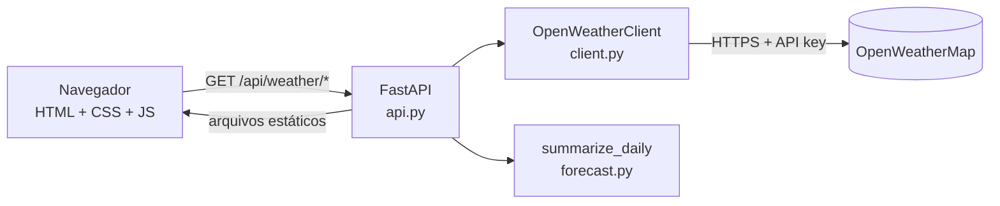

# Weather Dashboard

[](https://github.com/luanaroberto-crypto/mvp/actions/workflows/ci.yml)


Dashboard web de monitoramento de clima: busque qualquer cidade e veja as condições atuais
(temperatura, sensação térmica, umidade, vento, pressão) e a previsão resumida dos próximos
5 dias. Os dados vêm da API do [OpenWeatherMap](https://openweathermap.org/).

Projeto desenvolvido como **MVP do Mini Projeto do Curso 4**, com foco em boas práticas de
engenharia: testes automatizados, tipagem estática, CI, gestão segura de credenciais e
histórico de commits no padrão Conventional Commits.

---

## Sumário

- [Funcionalidades](#funcionalidades)
- [Escopo do MVP](#escopo-do-mvp)
- [Arquitetura](#arquitetura)
- [Tecnologias](#tecnologias)
- [Pré-requisitos](#pré-requisitos)
- [Instalação](#instalação)
- [Configuração (variáveis de ambiente)](#configuração-variáveis-de-ambiente)
- [Como executar](#como-executar)
- [Como executar os testes](#como-executar-os-testes)
- [API](#api)
- [Estrutura do projeto](#estrutura-do-projeto)
- [Segurança](#segurança)
- [Uso de IA generativa no desenvolvimento](#uso-de-ia-generativa-no-desenvolvimento)
- [Próximos passos](#próximos-passos)
- [Contribuição e padrão de commits](#contribuição-e-padrão-de-commits)
- [Licença](#licença)

---

## Funcionalidades

- 🔎 Busca de cidade por nome, com código de país opcional (`Paris,FR`)
- 🌡️ Clima atual: temperatura, sensação, mínima/máxima, umidade, vento (km/h) e pressão
- 📅 Previsão de 5 dias agregada por dia (mínima, máxima, umidade média e condição dominante)
- 🕘 Buscas recentes salvas no navegador para acesso rápido
- 🌗 Tema claro/escuro automático e layout responsivo (desktop e celular)
- ♿ Acessível por teclado e leitor de tela (labels, `aria-live`, foco visível)
- 🩺 Endpoint `/health` e documentação interativa da API em `/docs`

## Escopo do MVP

| ✅ Dentro do escopo (v1.0.0) | ⏳ Fora do escopo (iterações futuras) |
|---|---|
| Busca por nome de cidade | Geolocalização automática do usuário |
| Clima atual + previsão de 5 dias | Gráficos históricos e alertas meteorológicos |
| Unidades métricas (°C, km/h) | Alternância °C/°F na interface |
| Buscas recentes no navegador | Contas de usuário e cidades favoritas no servidor |
| Backend como proxy seguro da API | Cache de respostas e rate limiting |
| Testes automatizados + CI | Testes end-to-end com navegador (Playwright) |

## Arquitetura

O navegador **nunca** fala diretamente com o OpenWeatherMap. O backend FastAPI atua como
proxy: guarda a chave de API no servidor, valida a entrada, normaliza a resposta e entrega
ao frontend apenas os dados de que ele precisa.



| Camada | Arquivo | Responsabilidade |
|---|---|---|
| Configuração | `config.py` | Lê e valida variáveis de ambiente (`pydantic-settings`) |
| Integração | `client.py` | Chama o OpenWeatherMap e traduz erros/payloads para o domínio |
| Domínio | `models.py`, `forecast.py` | Modelos Pydantic e agregação diária (lógica pura) |
| API | `api.py`, `main.py` | Rotas, validação, mapeamento de erros e cabeçalhos de segurança |
| Frontend | `static/` | Interface; `format.js` concentra a lógica pura e testável |

## Tecnologias

- **Backend:** Python 3.12, [FastAPI](https://fastapi.tiangolo.com/), [httpx](https://www.python-httpx.org/) (assíncrono), Pydantic v2, Uvicorn
- **Frontend:** HTML5, CSS3 e JavaScript (ES Modules) — sem etapa de build
- **Testes:** pytest, pytest-cov, respx (mock de HTTP), `node:test`
- **Qualidade:** ruff (lint + formatação), mypy (modo estrito), GitHub Actions

## Pré-requisitos

- [Python 3.12+](https://www.python.org/downloads/)
- [Node.js 20+](https://nodejs.org/) — apenas para rodar os testes do frontend
- Uma chave de API gratuita do OpenWeatherMap:
  [crie uma conta](https://home.openweathermap.org/users/sign_up) e copie a chave em
  *API keys*. Chaves novas podem levar alguns minutos (até ~2 h) para serem ativadas.

## Instalação

```bash
git clone https://github.com/luanaroberto-crypto/mvp.git
cd mvp

python -m venv .venv
# Windows (PowerShell)
.venv\Scripts\Activate.ps1
# Linux / macOS
source .venv/bin/activate

pip install -r requirements-dev.txt   # ou requirements.txt para apenas executar
```

## Configuração (variáveis de ambiente)

Copie o arquivo de exemplo e preencha sua chave:

```bash
cp .env.example .env          # Windows: copy .env.example .env
```

| Variável | Obrigatória | Padrão | Descrição |
|---|---|---|---|
| `OPENWEATHER_API_KEY` | ✅ | — | Chave de API do OpenWeatherMap |
| `OPENWEATHER_BASE_URL` | | `https://api.openweathermap.org/data/2.5` | URL base da API |
| `OPENWEATHER_TIMEOUT_SECONDS` | | `5.0` | Timeout das requisições externas (0–30 s) |
| `OPENWEATHER_UNITS` | | `metric` | `metric` ou `imperial` |
| `OPENWEATHER_LANG` | | `pt_br` | Idioma das descrições do clima |

> ⚠️ O arquivo `.env` está no `.gitignore` e **nunca** deve ser commitado.

## Como executar

```bash
uvicorn weather_dashboard.main:app --app-dir src --reload
```

Acesse:

- Dashboard: <http://localhost:8000>
- Documentação da API (Swagger): <http://localhost:8000/docs>
- Health check: <http://localhost:8000/health>

## Como executar os testes

```bash
# Testes Python (unitários + integração) com relatório de cobertura
pytest --cov

# Testes do frontend (funções puras de formatação)
node --test "tests/js/**/*.test.mjs"

# Verificações de qualidade (as mesmas do CI)
ruff check src tests
ruff format --check src tests
mypy src
```

Os testes **não acessam a internet nem precisam de chave real**: as chamadas ao
OpenWeatherMap são simuladas com `respx`, e os testes da API substituem o cliente por um
dublê via `app.dependency_overrides`.

| Suíte | O que cobre |
|---|---|
| `tests/test_config.py` | Leitura de variáveis, falha rápida sem chave, mascaramento do segredo |
| `tests/test_client.py` | Parsing das respostas, fuso horário, 404/401/5xx, timeout, JSON inválido |
| `tests/test_forecast.py` | Agrupamento por dia, mín/máx, condição dominante e desempate |
| `tests/test_api.py` | Rotas, validação de cidade, mapeamento de erros, cabeçalhos de segurança |
| `tests/js/format.test.mjs` | Formatação de temperatura, vento, datas, ícones e buscas recentes |

## API

| Método | Rota | Parâmetros | Resposta |
|---|---|---|---|
| `GET` | `/api/weather/current` | `city` (obrigatório) | Clima atual da cidade |
| `GET` | `/api/weather/forecast` | `city` (obrigatório), `days` (1–5, padrão 5) | Previsão diária |
| `GET` | `/health` | — | `{"status": "ok", "version": "1.0.0"}` |

Exemplo:

```bash
curl "http://localhost:8000/api/weather/current?city=Curitiba"
```

```json
{
  "city": "Curitiba",
  "country": "BR",
  "temperature": 18.4,
  "feels_like": 18.1,
  "temp_min": 16.9,
  "temp_max": 19.8,
  "humidity": 77,
  "pressure": 1018,
  "wind_speed": 3.1,
  "description": "nublado",
  "icon": "04d",
  "observed_at": "2026-09-29T10:15:00-03:00"
}
```

| Código | Quando |
|---|---|
| `422` | Cidade vazia, inválida ou com mais de 100 caracteres; `days` fora de 1–5 |
| `404` | Cidade não encontrada no OpenWeatherMap |
| `502` | Provedor indisponível, chave inválida ou resposta inesperada |

## Estrutura do projeto

```
.
├── .github/workflows/ci.yml     # Pipeline de CI
├── src/weather_dashboard/
│   ├── api.py                   # Rotas REST e validação de entrada
│   ├── client.py                # Integração com o OpenWeatherMap
│   ├── config.py                # Configuração via variáveis de ambiente
│   ├── forecast.py              # Agregação da previsão por dia
│   ├── main.py                  # App FastAPI, erros e cabeçalhos de segurança
│   ├── models.py                # Modelos de domínio (Pydantic)
│   └── static/                  # Frontend (index.html, css/, js/)
├── tests/                       # Testes Python e tests/js/ (node:test)
├── .env.example                 # Modelo das variáveis de ambiente
├── pyproject.toml               # Metadados e configuração de ruff/mypy/pytest
├── requirements.txt             # Dependências de execução (versões fixadas)
├── requirements-dev.txt         # Dependências de desenvolvimento
├── CHANGELOG.md
└── LICENSE
```

## Segurança

- **Credenciais fora do código:** a chave fica apenas no `.env` (ignorado pelo Git), é
  carregada como `SecretStr` e nunca é registrada em logs nem enviada ao navegador.
  Nenhuma credencial foi commitada no histórico.
- **Validação no servidor:** o nome da cidade é normalizado e validado por tamanho e
  caracteres permitidos, e o código do ícone é validado por regex antes de virar URL.
- **Proteção contra XSS:** o frontend usa apenas `textContent`/`createElement`, e a página
  é servida com `Content-Security-Policy` restritiva, `X-Frame-Options: DENY` e
  `X-Content-Type-Options: nosniff`.
- **Erros sem vazamento:** falhas do provedor retornam mensagem genérica (502); os detalhes
  ficam apenas no log do servidor.

## Uso de IA generativa no desenvolvimento

A IA generativa (Claude Code) foi usada ao longo de várias etapas, sempre com revisão
humana e validação por testes automatizados:

| Etapa | Como a IA ajudou | Como a saída foi validada |
|---|---|---|
| Planejamento | Definição do escopo do MVP e da arquitetura com proxy | Revisão do escopo "dentro/fora" |
| Geração de código | Cliente HTTP, modelos, rotas e frontend | ruff, mypy estrito e testes |
| Testes | Casos de borda (404, timeout, JSON inválido, XSS no ícone) | Execução da suíte e cobertura ≥ 90% |
| Revisão / refatoração | Tipagem genérica de `_parse`, correção de conflito com a variável `LANG` do SO | Testes de regressão |
| Documentação | README, docstrings e CHANGELOG | Leitura crítica e conferência dos comandos |

## Próximos passos

- Cache em memória das respostas (reduz chamadas e latência)
- Geolocalização do usuário e alternância °C/°F
- Testes end-to-end com Playwright
- Imagem Docker para deploy

## Contribuição e padrão de commits

Este repositório segue [Conventional Commits](https://www.conventionalcommits.org/pt-br/):
`feat:` (nova funcionalidade), `fix:` (correção), `docs:`, `test:`, `refactor:`, `ci:`,
`chore:`. As versões seguem [Versionamento Semântico](https://semver.org/lang/pt-BR/) e as
mudanças são registradas no [CHANGELOG](CHANGELOG.md).

1. Crie uma branch a partir da `main` (`feat/minha-funcionalidade`)
2. Garanta que `pytest`, `ruff` e `mypy` passam localmente
3. Abra um Pull Request — o CI precisa estar verde

## Licença

Distribuído sob a licença MIT. Veja [LICENSE](LICENSE) para mais detalhes.
